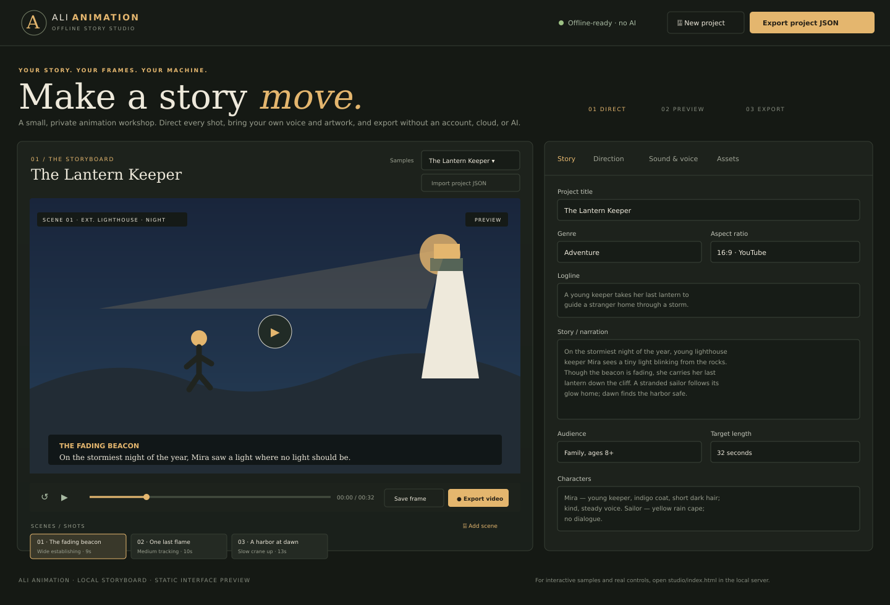

<p align="center"></p>

<h1 align="center">ALI Animation</h1>
<p align="center"><strong>Offline Story Studio — direct a story, animate a preview, export a video.</strong><br>Local-first. No AI, account, API key, or internet connection required at runtime.</p>

**[Open the Studio](studio/index.html)** · **[Standalone HTML installation & user guide](ALI-Animation-Guide.html)** · **[Install notes](INSTALL.md)** · **[Story JSON format](studio/story-format.md)** · **[4 sample projects](studio/samples/)** · **[UI preview](docs/screenshots/ali-animation-interface-preview.png)**

ALI Animation is a self-contained browser app for story-first animation. Write the story and characters, direct scene-by-scene camera angles, add voice/music/effects and reference art, preview the animation, and export a portable JSON project, PNG frames, and WebM video. Projects and media remain on your device.

## Start in minutes

1. Copy/download the repository and install Python 3.8+.
2. Open a terminal in `studio/` and run `python -m http.server 8765 --bind 127.0.0.1` (Windows: `py -m http.server 8765 --bind 127.0.0.1`).
3. Open `http://127.0.0.1:8765` in Firefox, Chrome, or Edge. After files are present, the studio works offline. See [INSTALL.md](INSTALL.md).

## What is included

- **Four complete story samples:** The Lantern Keeper, The Last Seed, The Moon Ferry and The Brave Little Cloud. Each has three shots, a story, characters, camera directions, narration/dialogue, sound cues, transitions and timing.
- **All-UI project editing:** story, logline, characters, genre, target length, visual style, palette, camera menu, shot timing, narration, dialogue, transitions, sound cues and reference art.
- **Import/export:** fill the UI or import a versioned JSON file; export the editable project with uploaded media embedded. A blank project template and field-by-field format guide are included.
- **Local preview + exports:** procedural 2D animation in Canvas, timeline playback, PNG stills, and browser-generated WebM video. Uploaded narration/music and timed SFX can accompany the video.
- **No app dependencies:** Python's standard library serves the files. No packages, AI, service, key, or online API are used by the Studio.

The Canvas output is an offline story animatic, not a full hand-drawn production package or a professional video editor. Speech playback depends on voices already installed on the user's computer; for dependable narration, upload a recording you own. WebM export depends on browser support. Read the scope and caveats in [INSTALL.md](INSTALL.md).

## Test

```sh
node --test studio/test-*.mjs
python -m unittest discover -s tests
```

## Existing repository material

The existing `skills/` directories contain the earlier ALI Animation/Sumi assistant plugin, studies, examples and production recipes. They are retained as legacy source; ALI Animation Studio does not call or require that assistant workflow. Only rename/update those integrations separately if they are still needed.
